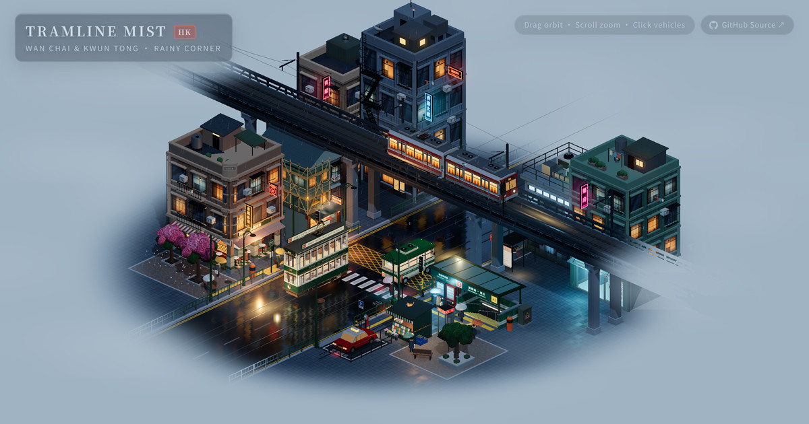

# TRAMLINE MIST // 香江雨霧・叮叮

**A Zero-Asset Procedural 3D Hong Kong Rainy-Corner Diorama, Planar Reflection Shader & Spatial Soundscape**

[](https://h-void.github.io/hk-tram-mist/?lang=en)
[](https://h-void.github.io/hk-tram-mist/?lang=en&mode=print)
[](./LICENSE)

Built with **Three.js · TypeScript · Custom GLSL Shaders · Procedural Canvas PBR · Web Audio API** (`0` external 3D models, `0` runtime image assets, `0` audio samples)

> *A compressed spatial memory of rainy Hong Kong: Hong Kong Island's green double-decker tramways, a Wan Chai cha chaan teng and bamboo-scaffolded tenement, and Kowloon's elevated Kwun Tong Line viaduct converge into a floating orthographic diorama suspended in radial monsoon mist.*

<p align="center">
  <a href="https://h-void.github.io/hk-tram-mist/?lang=en">
    
  </a>
</p>

---

## Core Graphics & Audio Architecture

1. **Zero-Asset Procedural 3D Architecture, Living Street & Canvas PBR (`src/scene/buildings.ts`, `viaductAndVehicles.ts`, `propsAndLife.ts`, `textures.ts`, `hkSignal.ts`)**
   - Every architectural volume, double-decker tram (`#120` with sweeping rain wiper, wet-catenary micro-spark, rear ruby tail-glow, wheel mist spray, teak benches, brass rails & passengers), **16-seat Green-Roof Hong Kong Minibus (`#28 銅鑼灣` with rotating wheels, twin wipers, backlit route placards, sculpted twin-fan AC pod, sliding window mullions, interior `58 km/h` LED speedometer & cabin silhouettes)**, elevated Kwun Tong Line viaduct with under-soffit linear light fixtures and 2-car Metro-Cammell train (elongated dual-rail headlight glint & pantograph micro-sparks), idling red Hong Kong taxi, 1958 curved Streamline Moderne *cha chaan teng* rooftop terrace, Chinese gable noodle shop with rising broth steam & swaying red *dai pai dong* lamp, bamboo scaffold with **pulsing amber safety beacon (`地盤閃燈`) & bilingual caution banner**, stepped Kowloon companion tenement (`B6`), jade mosaic tenement (`B4`) with warm-lit rooftop shack & laundry line, Wan Chai MTR Exit A3 canopy with dual-map backlit vending machines, **East Under-Viaduct Route 101 Bus Stop Shelter**, airy layered Bauhinia & weeping banyan trees, illuminated vintage telephone booth, pillar postbox, **newspaper kiosk with animated ginger-white roof cat**, spinning rooftop whirlybird turbines & HVAC chiller fans, `望左/望右` tarmac stencils, and yellow tactile guide paths is constructed purely from TypeScript geometry and deterministic Canvas2D albedo/roughness/emissive/bump textures (**`3,999` meshes · `119,480` triangles · `~237 KB` gzipped**).
   - **3D Glass Neon Tubes & Volumetric Monsoon Mist Halos**: Every projecting Hong Kong neon sign pairs 3D glowing glass perimeter trim tubes with preset-balanced humid-air additive mist halos.
   - **Synchronized 14-Second Hong Kong Traffic Signal & Articulated Life**: Shared authentic 5-stage / 4-vehicle-phase Hong Kong Transport Department traffic lights (`src/scene/hkSignal.ts`: Vehicle Red + Steady Green Man → Vehicle Red + 2.8 Hz Flashing Green Man → Vehicle Red+Amber pre-green + Pedestrian Red → Vehicle Green → Vehicle Amber, with zero overlap between Flashing Green Man and Red+Amber) mathematically phase-locked to 28-second Tram #120 and Minibus #28 loops, **live-colored wet-asphalt traffic-signal puddle reflections**, and 3 articulated strolling pedestrians (including a zebra-crossing walker who clears the crosswalk before Red Man and waits politely at the curb), plus gliding rain-mist pigeons and gravity-accelerated eave rain drips with ground impact splash ripples.

2. **Orthographic-Compatible Rain-Rippled Planar Wet Reflection & Radial Mist Shaders (`src/scene/roadAndReflections.ts`, `atmosphere.ts`)**
   - **`PlanarWetReflector`**: Renders a live mirrored scene pass to a **`768×768 HalfFloat`** render target (automatically falling back to `UnsignedByteType` across both the reflector and `EffectComposer` pipeline when `EXT_color_buffer_float` / `EXT_color_buffer_half_float` is unavailable) with zero per-frame object allocations, then applies **procedural GLSL multi-cell expanding raindrop ripple normal perturbation**, a **9-tap anisotropic vertical-streaking wet-asphalt blur**, **HDR soft-knee highlight compression**, chromatic neon saturation preservation, and wet dark-tar Fresnel grading.
   - **Injected World-Space Radial Mist (`applyRadialMistFade`)**: Patches Three.js PBR, `LineBasicMaterial`, and instanced materials via `onBeforeCompile` so roads, rails, viaducts, and north-west skyline silhouettes dissolve seamlessly into monsoon mist across both landscape and tall portrait viewports with zero hard diorama edges.
   - **Orthographic/Perspective Volumetric Light Cones (`createSoftLightConeMaterial`)**: Custom GLSL Fresnel + axial fade cones eliminating hard-edged cone silhouettes alongside 12 preset-balanced street/shop/under-viaduct point lights (plus 4 vehicle-mounted headlight and pantograph-spark point lights).

3. **`[P]` Archival Axonometric Engraving & `[A]` GLSL Spatial Acoustic Field (`src/scene/weatherAndEffects.ts`)**
   - **`[P]` Print Mode & Built-In Hidden-Line Vector SVG Export**: Switches cleanly to `NoToneMapping` for true Xuan-paper matte surfaces (`#F4EFE6`) with delicate blush/celadon botanical washes for trees, lazily extracts and caches crisp `26°` `EdgesGeometry` architectural line art in Prussian blue, pine soot, and cinnabar red (highlighting Tram #120 and the red taxi) for instant repeat toggles, feathers outer ink lines smoothly into Xuan-paper margins via radial mist fade, filters foliage and decorative micro-meshes (`skipPrintEdges`), keeps moving vehicles and walking pedestrians synced live, and provides a **built-in HUD SVG export button** (`SVG` / `匯出 SVG`) in `[P]` mode backed by a **GPU-clamped, aspect-matched orthographic 24-bit depth-buffered hidden-line-removed Vector SVG exporter** (`__SCENE_CTRL__.getPrintEdgeSVG`).
   - **`[A]` GLSL Acoustic Field Mode & Tapered Drizzle**: Uses a custom multi-harmonic radial wavefront GLSL shader to visualize live sound wavefronts radiating from neon transformers, tram rails, elevated viaduct trains, Minibus #28, **phase-locked HK pedestrian crossing beeper pulses**, rainfall, and interactive vehicle bell/horn pulses, paired with tapered GLSL falling drizzle streaks, eave drips with impact ripples, and rising noodle-shop steam.

4. **Procedural Hong Kong Web Audio Soundscape (`src/audio/hkSoundscape.ts`)**
   - Synthesizes filtered stereo pink-noise monsoon rain with breeze LFO modulation, randomized tin-roof raindrop bandpass bursts, subtle Hong Kong 50/100 Hz neon ballast hum, proximity-modulated steel rail rumble, **phase-locked Hong Kong audible pedestrian crossing piezo cadence** (`1.25 Hz` steady green → `6.25 Hz` flashing green → silent on Red Man / Red+Amber), a 5-partial metallic double-ding tram bell (`1,285 Hz` / `1,302 Hz`), and polite dual-tone Hong Kong vehicle horns for the Green-Roof Minibus (`392/494 Hz`) and Red Taxi (`440/554 Hz`), with tab-visibility suspend/resume and strict mute routing across both ambient and SFX buses.

---

## Controls & URL Parameters

- **Orbit / Zoom / Pan**: Drag to rotate, scroll/pinch to zoom (with aspect-aware portrait frustum scaling for mobile), click the **double-decker tram** (or press `Space`) for the double-ding bell, or click the **Green-Roof Minibus / Red Taxi** for dual-tone horns and vehicle-colored wavefront pulses.
- **`1` / `2` / `3`**: Dusk Mist · Midnight Neon · Dawn Mist lighting & bloom presets.
- **`Q` / `W` / `E`**: Isometric Overview · Tram Follow Close-Up · Street Corner cameras.
- **`[A]`**: Toggle Spatial Acoustic Wavefront Field.
- **`[P]`**: Toggle Archival Axonometric Print Mode (reveals the built-in `SVG` / `匯出 SVG` hidden-line vector download button).
- **`[M]`**: Toggle procedural rain, street ambiance & vehicle SFX soundscape.
- **URL Parameters**: `?lang=en` (default) | `?lang=zh` (synced live on language toggle), `?preset=dusk|midnight|dawn`, `?view=iso|tram|street`, `?mode=diorama|acoustic|print`, `?hud=0|1`, `?t=<seconds>`.

---

## Local Development

```bash
npm ci
npm run dev      # Local Vite dev server
npm run build    # Strict TypeScript check + relative-base Vite production bundle -> dist/
npm run preview  # Preview dist/ locally
```

## License

MIT
